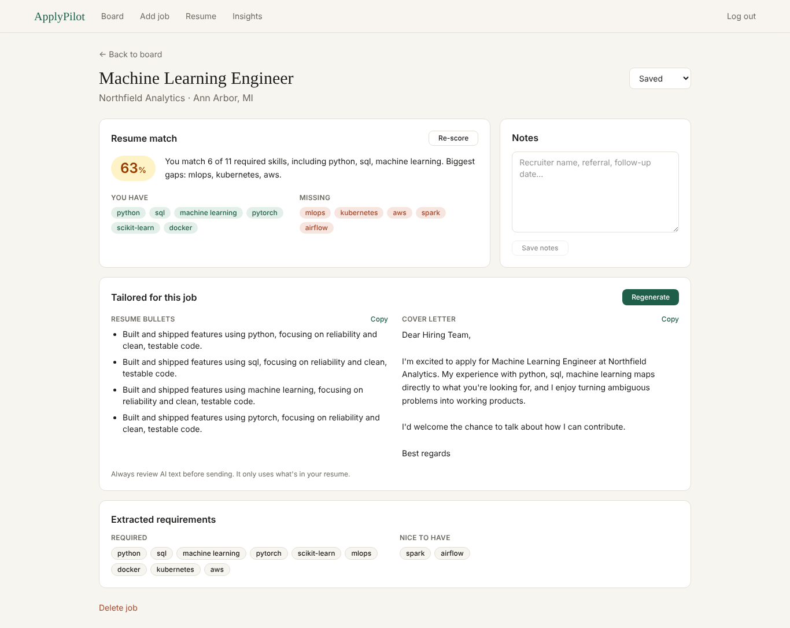
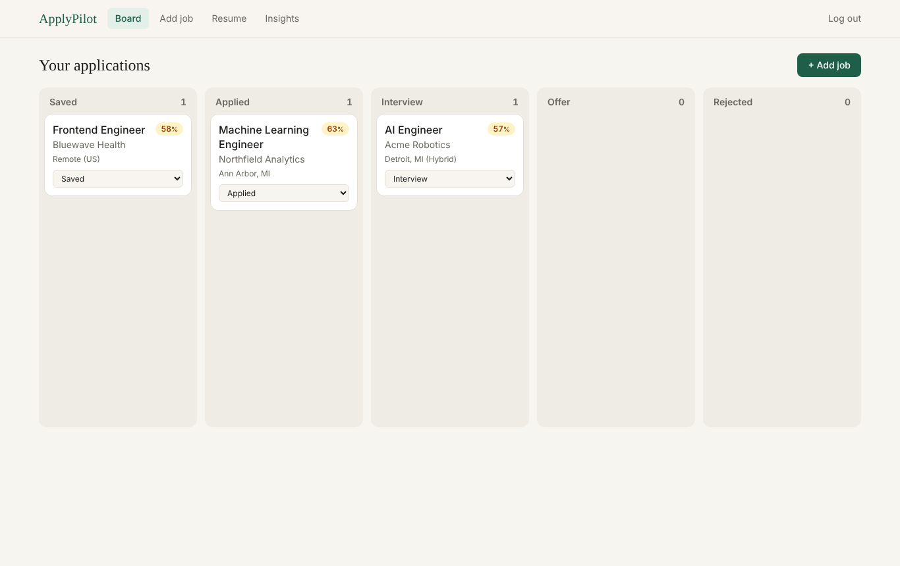
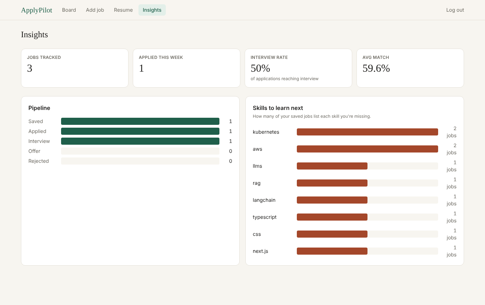

# ApplyPilot: AI Job Application Tracker

Paste any job posting and ApplyPilot will:

1. **Extract** the company, role, location, salary and skills with an LLM (validated JSON, not free text)
2. **Score** how well your resume fits (0–100) and show the skills you have vs. the ones you're missing
3. **Tailor** resume bullets and a short cover letter for that job, using only what's in your resume
4. **Track** every application on a drag-and-drop board (Saved → Applied → Interview → Offer → Rejected)
5. **Show insights**: interview rate, average match, and *which missing skills show up most across your jobs*



| Board | Insights |
|---|---|
|  |  |

## Tech stack

| Layer | Tech |
|---|---|
| Frontend | React 19, Vite, Tailwind CSS v4, React Router |
| Backend | Python, FastAPI, SQLAlchemy 2, Pydantic v2 |
| Database | SQLite (local) / PostgreSQL (production) |
| AI | OpenAI or Anthropic via a provider interface; offline mock provider for tests |
| Auth | bcrypt password hashing + JWT bearer tokens |
| Infra | Docker, Docker Compose, nginx, GitHub Actions CI |

## Architecture

```
React (Vite)  ──HTTP/JSON + JWT──▶  FastAPI
                                     ├── routers/      thin HTTP layer (auth, resumes, jobs, dashboard)
                                     ├── services.py   prompts + orchestration + rate limiting
                                     ├── llm.py        provider interface, JSON validation + retry
                                     ├── matching.py   score = 70% skill coverage + 30% similarity
                                     └── models.py ──▶ SQLite / PostgreSQL
```

**Add-job flow:** paste posting → LLM extracts fields into a strict Pydantic schema (one automatic retry
if the JSON is invalid) → optional embedding → score computed *in code* against your latest resume →
LLM writes a 2–3 sentence explanation → saved and shown on the board.

## Run it locally (no API key needed)

**Backend** (Python 3.11+)
```bash
cd backend
python -m venv .venv && source .venv/bin/activate     # Windows: .venv\Scripts\activate
pip install -r requirements-dev.txt
cp .env.example .env            # LLM_PROVIDER=mock works offline
uvicorn app.main:app --reload   # API at http://localhost:8000, docs at /docs
pytest -q                       # 22 tests
```

**Frontend** (Node 20+), in a second terminal
```bash
cd frontend
npm install
npm run dev                     # http://localhost:5173
```

To use a real model, set `LLM_PROVIDER=openai` and `OPENAI_API_KEY=...` (or `anthropic` and
`ANTHROPIC_API_KEY=...`) in `backend/.env` and restart. OpenAI also enables embedding-based similarity.

**Or everything with Docker** (Postgres + API + nginx):
```bash
cp backend/.env.example backend/.env
docker compose up --build       # open http://localhost:8080
```

## Deploy (free tiers)

1. **Database:** create a Postgres database on [Neon](https://neon.tech) or [Supabase](https://supabase.com).
   Copy the connection string and change the prefix to `postgresql+psycopg://`.
2. **Backend:** on [Render](https://render.com), New → Web Service → your repo, root directory `backend`,
   runtime Docker. Set env vars: `DATABASE_URL`, `JWT_SECRET`, `LLM_PROVIDER`, the API key,
   and `CORS_ORIGINS=https://<your-vercel-app>.vercel.app`.
3. **Frontend:** on [Vercel](https://vercel.com), import the repo, root directory `frontend`,
   env var `VITE_API_URL=https://<your-render-api>.onrender.com`.

## API

| Method | Path | What it does |
|---|---|---|
| POST | `/api/auth/signup`, `/api/auth/login` | Returns a JWT |
| GET | `/api/auth/me` | Current user |
| POST | `/api/resumes` | Upload PDF/TXT, extract skills, re-score recent jobs |
| GET | `/api/resumes/latest` | Latest resume |
| POST | `/api/jobs` | Extract + score a pasted job posting |
| GET | `/api/jobs`, `/api/jobs/{id}` | List / get |
| PATCH | `/api/jobs/{id}` | Change status or notes |
| DELETE | `/api/jobs/{id}` | Delete |
| POST | `/api/jobs/{id}/rematch` | Re-score against latest resume |
| POST | `/api/jobs/{id}/tailor` | Generate bullets + cover letter |
| GET | `/api/dashboard` | Stats and top missing skills |

Interactive docs: `http://localhost:8000/docs`.

## Design decisions

- **The LLM explains the score, it doesn't invent it.** Scores are computed deterministically so the same
  resume and job always get the same number.
- **Every LLM response is schema-validated** with one self-repair retry; failures return a clean 502.
- **Prompt-injection defence:** postings and resumes are wrapped in tags and treated as data.
- **Per-user AI rate limit** (default 30/hour) protects the API bill.
- **Users can only see their own data**; other users' IDs return 404.
- **Provider interface** means OpenAI, Anthropic or the offline mock are a one-line config change.

## Roadmap

- Chrome extension to save a posting in one click
- Follow-up reminders by email
- pgvector + Alembic migrations
- Interview-prep questions per job
